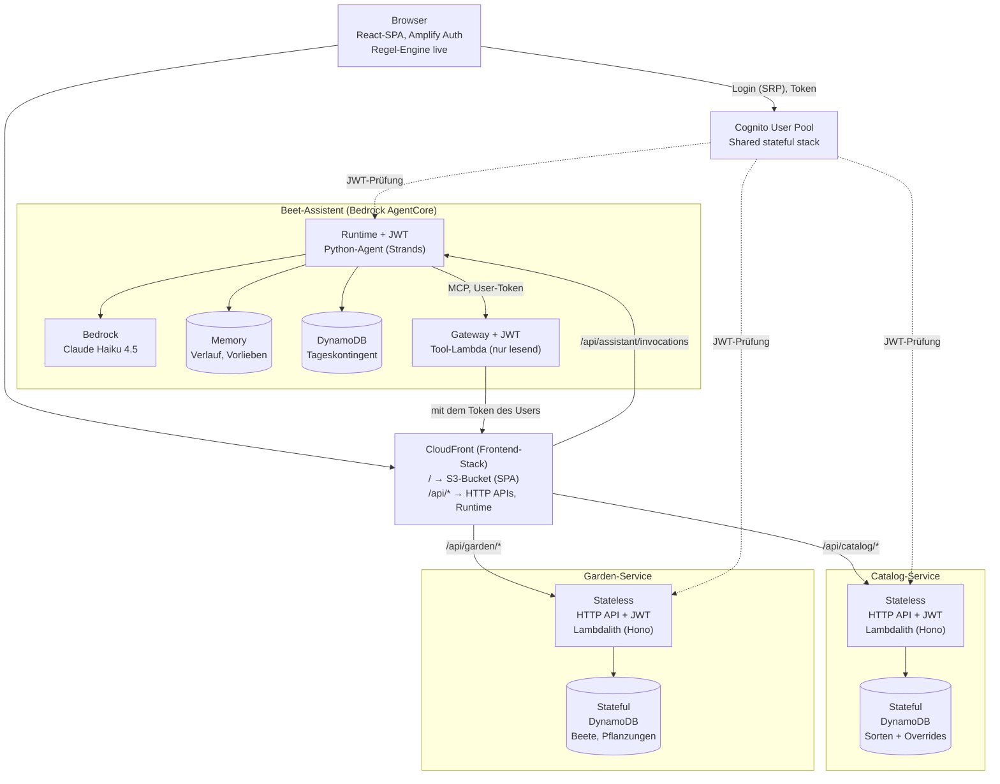

# Hochbeet-Planer – Architektur

Stand: 15. Oktober 2026

Dieses Dokument gibt den Überblick: Ziele, Bausteine, wie sie zusammenspielen, und die Grundregeln, die überall gelten. Die Details stehen je Thema unter [`docs/architecture/`](./architecture/). Alles hier und dort ist **verbindlich**; weicht eine Umsetzung ab, wird das passende Dokument im selben PR angepasst.

## Überblick

Der Hochbeet-Planer ist eine Web-App, in der angemeldete User ihre Hochbeete maßstabsgetreu planen und über die Zeit bepflanzen. Die App warnt bei zu geringem Pflanzabstand, schlechten Nachbarn, benachbarten Starkzehrern und Fruchtfolge-Fehlern, lässt das Speichern aber immer zu. Ohne Konto geht das im Gastmodus im Browser; ein KI-Assistent erklärt Warnungen und schlägt Pflanzungen vor.

Rahmenbedingungen:

- Spaßprojekt, zunächst nur die Umgebung `prod`; `dev` kann später ergänzt werden.
- Ein GitHub-Monorepo, durchgängig TypeScript für Frontend, Backend und IaC; einzige Ausnahme ist der Python-Agent des Beet-Assistenten.
- Komplett serverless auf AWS, Kosten im Leerlauf nahe null.
- Desktop und Mobile sind gleichwertige Zielplattformen.
- Login per E-Mail und Passwort über Cognito; Google-Login kann später folgen.
- Umsetzungsaufgaben liegen als GitHub-Issues vor (Label `task`, Epics mit Label `epic`).

## Systemarchitektur



Der Browser meldet sich bei Cognito an und erreicht SPA, beide APIs und den Assistenten über eine einzige CloudFront-Domain. Die Regel-Engine läuft im Browser. Die Services speichern nur und rufen sich nie gegenseitig auf. Der Assistent liest Beete und Katalog ausschließlich über seine Gateway-Tools, die mit dem Token des Users dieselben APIs wie die App aufrufen.

## Bausteine

| Baustein | Code | Kurz | Details |
| --- | --- | --- | --- |
| Domänenmodell | `packages/contracts` | Beet, Pflanzung, Sorte, Standfläche; Wochen nach ISO-8601, Saisongrenze je Beet | [domain.md](./architecture/domain.md) |
| Regel-Engine | `packages/garden-rules` | Reines TypeScript, berechnet alle Warnungen in App und Tools; `evaluateBed()` ist der einzige Einstieg | [rules.md](./architecture/rules.md) |
| Pflanzenkatalog | `services/catalog`, `packages/catalog-seed`, `packages/plant-icons` | Globale, angepasste und eigene Sorten, Veröffentlichung über den Admin, Startkatalog, Icons | [catalog.md](./architecture/catalog.md) |
| Garden-Service | `services/garden` | Beete und Pflanzungen je User, Übernahme aus dem Gastmodus | [garden.md](./architecture/garden.md) |
| Backend allgemein | `packages/service-kit` | HTTP API + Lambdalith (Hono), Auth aus dem JWT, Logging, deutsche Fehler | [backend.md](./architecture/backend.md) |
| Beet-Assistent | `agents/bed-assistant`, `services/assistant-tools` | Strands-Agent auf AgentCore mit Kostengrenzen, Gateway-Tools, Gedächtnis, Pflanzvorschlägen und Tracing | [assistant.md](./architecture/assistant.md) |
| Frontend | `apps/web` | React-SPA mit Katalog, Beet-Editor, Gastmodus, Anmeldung und Mobile-Bedienung | [frontend.md](./architecture/frontend.md) |
| Infrastruktur | `infra` | CDK-Stacks, CloudFront, SSM-Parameter, Cognito, cdk-nag | [infrastructure.md](./architecture/infrastructure.md) |
| Tests und CI/CD | `e2e`, `.github/workflows` | Teststrategie, Playwright, Pipeline, Deploy nach `prod` | [testing.md](./architecture/testing.md) |

Weitere Dokumente: [`deployment.md`](./deployment.md) (Einrichtung, Betrieb, Fehlersuche), [`startkatalog.md`](./startkatalog.md) (die 56 Sorten des Startkatalogs mit Quellen) und [`assistant-evaluation.md`](./assistant-evaluation.md) (Modellvergleich des Assistenten).

## Grundregeln

- **Warnungen** werden nie gespeichert und blockieren nie das Speichern; sie entstehen immer neu aus der Regel-Engine.
- **Längen** in cm, Positionen auf dem 5-cm-Raster mit Ursprung links oben im Beet; Daten als ISO-Strings, Pflanz- und Entfernungsdaten immer auf einem Montag.
- **Identität:** Die `userId` kommt im Backend nur aus dem `sub`-Claim des geprüften JWT, nie aus dem Request oder vom Modell.
- **API-Typen** entstehen nur aus Zod-Schemas in `packages/contracts`; Frontend, Services, Tools und der Agent (über exportierte JSON Schemas) nutzen dieselben.
- **Services** rufen sich nicht gegenseitig auf und prüfen nur die Struktur; öffentliche Routen nur unter `/api/<service>/public/`, nur lesend und ohne User-Daten.
- **Stacks** sind nach stateful und stateless getrennt; Werte zwischen Stacks fließen über SSM-Parameter.
- **Kosten** bleiben im Leerlauf nahe null; für den Assistenten gelten feste Grenzen (Tageskontingent, Tokens, Tool-Aufrufe, Runden, Budget), die nur nach Rücksprache gelockert werden.
- **Deploy** nur über GitHub Actions nach dem Merge auf `main`, nie aus Entwickler- oder Claude-Code-Sessions.

## Monorepo-Struktur

Das Repo nutzt pnpm Workspaces mit Turborepo für Builds, Tests und Caching.

```
hochbeet-planer/
├── apps/
│   └── web/                    # React + Vite + TS
├── services/
│   ├── catalog/                # Lambdalith (Hono), Handler, Repository, Tests
│   ├── garden/
│   └── assistant-tools/        # Lese-Tools und Interceptor des AgentCore Gateway
├── agents/
│   └── bed-assistant/          # Beet-Assistent: Python, Strands Agents, AgentCore Runtime
├── packages/
│   ├── garden-rules/           # Regel-Engine (pure TS, Frontend + Backend)
│   ├── contracts/              # Zod-Schemas = API-Typen für FE und BE
│   ├── catalog-seed/           # Startkatalog als typisierte Daten
│   ├── plant-icons/            # SVG-Icons je Sorte + React-Komponente
│   ├── service-kit/            # Gemeinsamer Service-Code (Hono-App, Auth, Fehler)
│   └── tsconfig/ eslint-config/
├── infra/                      # CDK-App
│   ├── bin/app.ts
│   └── lib/
│       ├── config/stages.ts
│       ├── shared/SharedStatefulStack.ts
│       ├── catalog/{Stateful,Stateless}Stack.ts
│       ├── garden/{Stateful,Stateless}Stack.ts
│       ├── assistant/Assistant{Stateful,}Stack.ts
│       └── frontend/FrontendStack.ts
├── e2e/                        # Playwright
├── docs/                       # architecture.md (Überblick), architecture/ (Details), weitere Dokumente
├── scripts/
└── .github/workflows/
```

Weiteres Tooling: TypeScript im Strict-Mode, ESLint mit Prettier, Vitest als einheitlicher Test-Runner; für den Agenten uv mit ruff, mypy strict und pytest (siehe [Beet-Assistent](./architecture/assistant.md)).

## Entscheidungen und Annahmen

- Starkzehrer-Regel: nur quer zur Reihenrichtung; hintereinander in einer Reihe ist erlaubt.
- Saisongrenze: „Erde erneuert am …“ pro Beet, Standard 1. März.
- Reihenrichtung: pro Beet wählbar, Standard parallel zur kürzeren Kante; gilt für Einzelpflanzen und als Vorbelegung neuer Reihen.
- Der Einflussradius für gute und schlechte Nachbarn beträgt wie bei Starkzehrern 30 cm.
- Reihen verlaufen immer parallel zu den Beetkanten.
- Region ist `eu-central-1`; die App läuft unter https://hochbeet.andi-john-dev.de (Hosted Zone `andi-john-dev.de` in Route 53, Zertifikat aus ACM in `us-east-1`).
- Pflanz- und Entfernungsdaten liegen immer auf einem Montag; Wochen folgen ISO-8601.
- Der eingebaute Cognito-Mailversand reicht für den Anfang.
